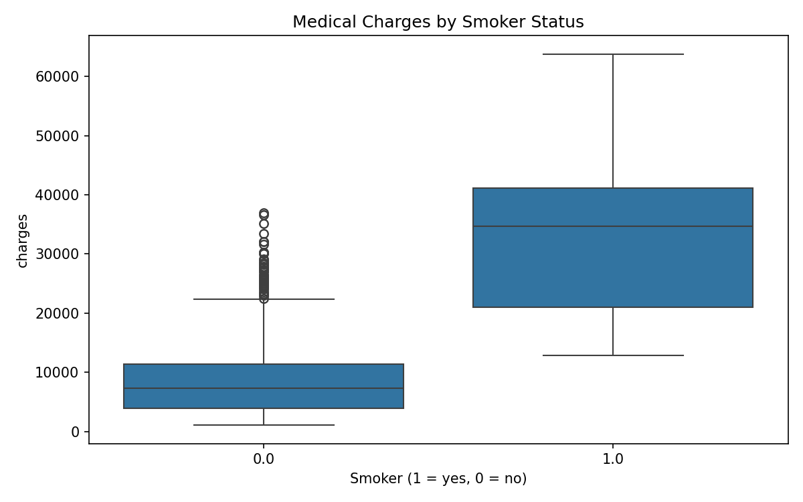

# Sun Jia — Data Science Portfolio

## Hi, I'm Sun Jia 👋

I am a graduate student in **Data Science (Precision Medicine track)** at the
**University of Macau**. With a clinical medicine background, I enjoy turning
raw data into clear evidence that supports health-related decisions, and I am
building this portfolio to document my data science journey.

## Technical skills

- **Python:** pandas, NumPy, Matplotlib, Seaborn, scikit-learn
- **Data visualization:** Plotly, Dash, Folium
- **Data wrangling & EDA:** missing-value imputation, feature engineering, correlation analysis
- **Modelling:** linear & polynomial regression, Ridge regularization, pipelines
- **Tools:** Jupyter Notebook, R basics, Git / GitHub

## Project showcase

### Medical Insurance Cost Prediction

**Research question:** Which factors most strongly drive individual medical
insurance charges, and how accurately can regression models predict them?

**Visualization — medical charges by smoker status:**

**Findings:** Smoker status is by far the strongest predictor — smokers pay
about **$23,805 more** on average, and a linear model using only `smoker`
already reaches R² ≈ **0.62**. Adding all features improves the linear model to
R² ≈ **0.75**, and a pipeline with scaling + polynomial features reaches
R² ≈ **0.85**. On a held-out test set, a Ridge model with degree-2 polynomial
features reaches R² ≈ **0.84**, showing that regularized nonlinear features
generalize best on this data.

- **Project repository:** [github.com/mc65187/data-science-project](https://github.com/mc65187/data-science-project)
- **Status:** ✅ Completed

---

*Built with GitHub Pages · Sun Jia · mc651874 · University of Macau*
